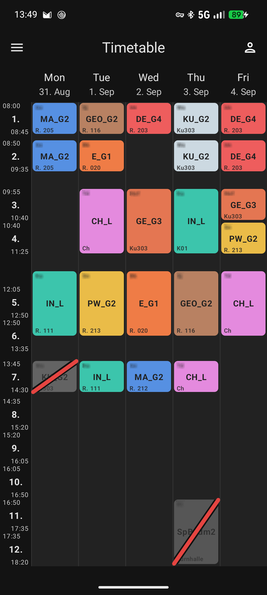
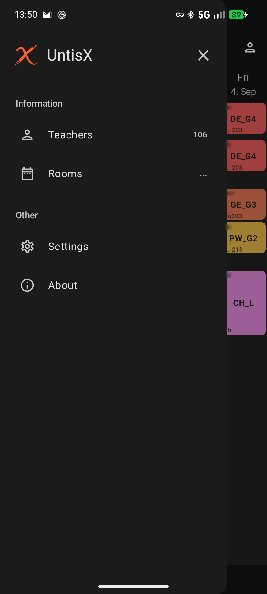
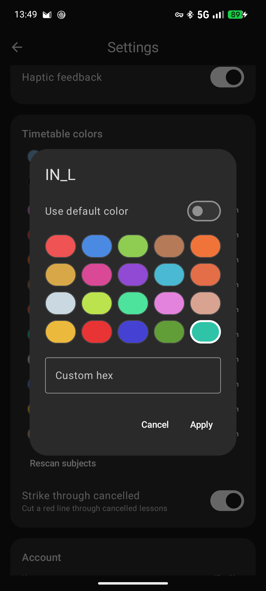
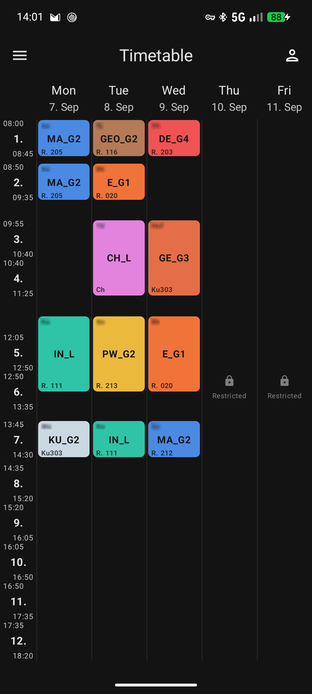

# UntisX

**by LSX Studios**

An open-source timetable viewer for the Untis school system - built natively with Kotlin and Jetpack Compose.

---

## Features

- **Timetable** - clear weekly view with all lessons, times, rooms and teachers
- **School events** - displayed directly in the timetable
- **Events overview** - upcoming school events, announcements and holidays with countdown in one place
- **Lesson details** - lesson information, substitutions, topic and class register notes
- **Cancelled lessons** - showing up grayed out
- **Subject colors** - every subject color can be customized
- **Teachers & rooms** - the whole school at a glance
- **Offline** - your timetable is cached locally and opens instantly
- **Notifications** - alerts for cancellations and room/teacher changes, automatically silent during lessons, plus an overview of the upcoming school day
- **In-app updates** - new versions install straight from the app
- **Lightweight** - small, fast, no ads, no tracking

UntisX is in early development - expect bugs and incomplete features. If you find one, please [report it as an issue](https://codeberg.org/Losterixx/UntisX/issues).

---

## Screenshots

| | |
|---|---|
|  |  |
|  |  |

---

## Privacy

Your username and password are sent exclusively to your school's Untis server and nowhere else. There is no analytics or tracking.

The only external contact besides your Untis server is this project's releases for updates.

If you enable notifications, UntisX periodically checks your timetable on your school's Untis server in the background (you can choose the interval and restrict it to Wi-Fi or school days). The data is compared locally on your device to detect changes - nothing is sent anywhere else.

---

## Building

```bash
git clone https://codeberg.org/Losterixx/UntisX
cd UntisX
./gradlew assembleDebug
```

or simply open the project in Android Studio. Debug builds work out of the box; release builds are signed with the project keystore.

---

## Note on AI

Parts of this project were written with AI assistance. All code has been carefully reviewed and manually tested before release.

---

## License

Open source - [GPL-3.0](LICENSE).

If you use or build upon this project, a credit to **LSX Studios** and a link to
<https://codeberg.org/Losterixx/UntisX> is much appreciated <3

---

Built with Kotlin + Jetpack Compose.
